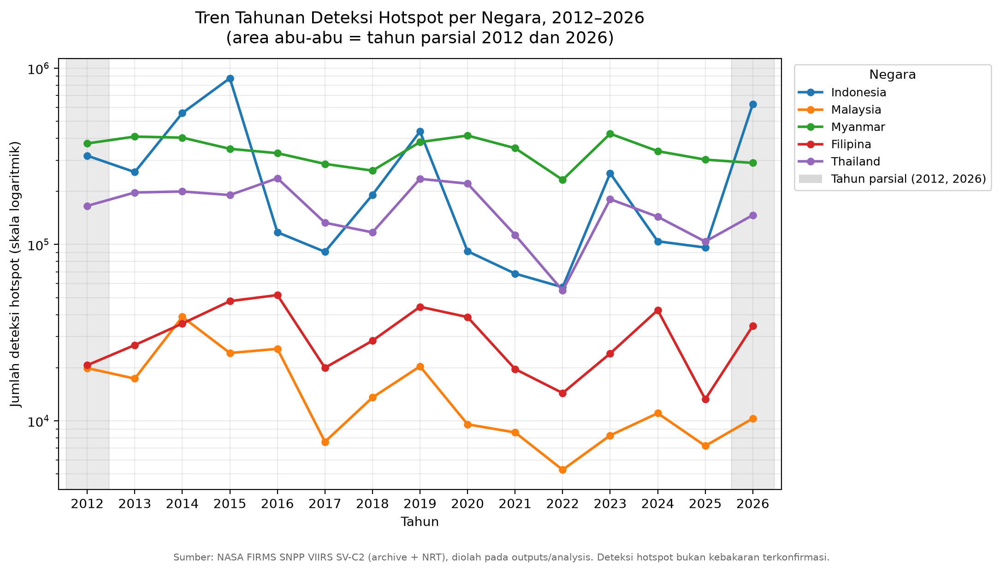
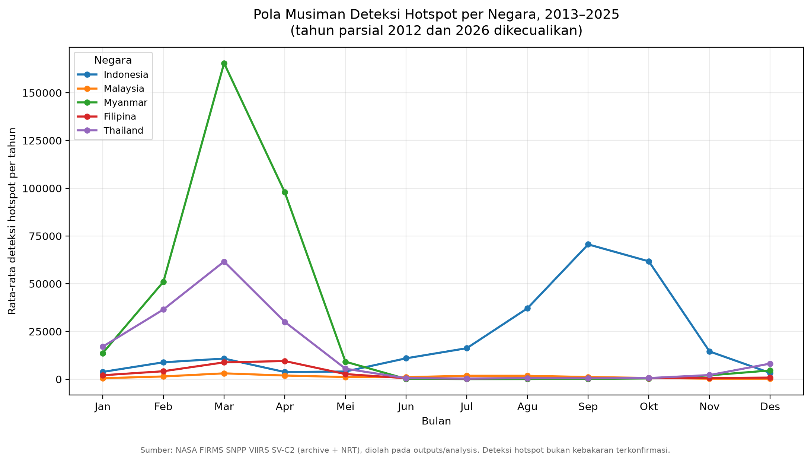

# Southeast Asia Forest & Land Fire Hotspot Analysis (2012–2026)

[](https://www.python.org/)
[](https://hadoop.apache.org/)
[](https://firms.modaps.eosdis.nasa.gov/)
[]()
[](LICENSE)

A descriptive Big Data analysis examining **12,416,036 satellite active fire hotspot detection records** across five Southeast Asian countries (**Indonesia, Malaysia, Myanmar, Philippines, and Thailand**) over nearly 15 years (January 20, 2012 – November 2, 2026).

This project integrates a single-node pseudo-distributed **Apache Hadoop HDFS** storage setup with a custom **single-pass streaming Python analytics engine** (operating without Spark, MapReduce, or YARN) to observe empirical temporal trends, seasonal distributions, 0.1° spatial detection density, and physical sensor attributes (Fire Radiative Power, confidence, diurnal cycles).

> **Methodological Scope & Interpretation Boundaries:**
> - **Descriptive Analysis Only:** This study provides observational summaries of satellite detections. It does **not** construct predictive models, fire propagation simulations, or early warning systems (EWS).
> - **Detections vs. Fires:** Reported figures represent individual satellite thermal detection pixel records, **not** confirmed wildfire events or burned surface areas.
> - **Spatial Grid Density:** Aggregation into 0.1° (~11 km) grid cells identifies areas of high detection concentration; it does **not** prove, identify, or attribute physical causes (such as industrial facilities, gas flaring, agricultural practices, or natural occurrences) without independent ground-truth verification.
> - **Distributed Architecture:** Apache Hadoop HDFS is deployed in a single-node pseudo-distributed configuration for educational distributed storage testing.

---

## Key Highlights & Findings

- **Big Data Scale:** Analyzed **12,416,036 rows** (1,003,377,955 bytes / ~956.90 MiB) across 10 official NASA FIRMS VIIRS S-NPP datasets (standard archive + Near Real-Time).
- **Single-Node Distributed Storage:** Apache Hadoop HDFS 3.5.0 cluster in single-node pseudo-distributed mode, storing 16 data blocks (128 MiB block size) verified as 100% HEALTHY with zero missing or corrupt blocks.
- **Single-Pass Streaming Compute:** Processed the entire 12.4M-row dataset using Python 3 standard library in **125.8 seconds** with a peak memory footprint of only **39.28 MiB RAM**, operating without distributed cluster engines (Spark, MapReduce, or YARN).
- **Observed Interannual Distribution:** Annual detection counts fluctuated substantially over the 15-year period. Across full calendar years (2013–2025), the highest annual count occurred in **2015 (1,486,854 detections)** and the lowest in **2022 (364,173 detections)**. These observations represent empirical counts without causal climate modeling.
- **Observed Seasonal Patterns (2013–2025 Full Years):**
  - *Northern Regional Group (Myanmar & Thailand):* Highest monthly concentrations occur between **February and April**, reaching an annual peak in March.
  - *Southern Regional Group (Indonesia & Malaysia):* Highest monthly concentrations occur between **August and October**, reaching an annual peak in September.
  - *Philippines:* Exhibits a more distributed pattern throughout the year with a moderate peak observed in March–May.
  *(Note: These figures reflect purely descriptive temporal distributions; agricultural burn schedules or monsoon winds are not established as causal drivers by this dataset.)*
- **Geographic Distribution:** Myanmar recorded the largest share of detections (**5,146,143; 41.5%**), followed by Indonesia (**4,140,587; 33.3%**), Thailand (**2,439,229; 19.6%**), Philippines (**462,349; 3.7%**), and Malaysia (**227,728; 1.8%**).
- **Spatial Detection Concentrations (0.1° Grids):** Aggregation at 0.1° resolution identified the top 20 densest detection clusters across the region. The highest detection concentration was centered at coordinate `(-2.6, 121.4)` in Sulawesi, Indonesia (24,204 detections). These grid cells indicate spatial detection density; the dataset alone does not identify or prove specific physical causes without independent ground-truth verification.

---

## Visualizations

### 1. Annual Hotspot Trends (2012–2026)
*Logarithmic scale comparison across five ASEAN countries. Shaded gray regions highlight partial observation years (2012 from Jan 20; 2026 up to Nov 2).*


### 2. Monthly Seasonality Patterns (2013–2025)
*Long-term monthly averages (excluding partial years 2012 and 2026) showing the observed temporal distribution between the northern region (Feb–Apr peak) and the southern region (Aug–Oct peak).*


### 3. Top 20 Spatial Hotspot Concentrations (0.1° Grid Cells)
*The 20 most concentrated 0.1° × 0.1° (~11 km) grid cells in Southeast Asia, labeled by country and coordinates.*


### 4. Detection Characteristics
*Comparison of detection confidence levels (low, nominal, high), diurnal pass ratios (daytime vs. nighttime), and mean Fire Radiative Power (MW).*


---

## Dataset Overview & Inventory

Data was acquired from the **NASA FIRMS** (Fire Information for Resource Management System) program using the **VIIRS** (Visible Infrared Imaging Radiometer Suite) instrument aboard the **Suomi-NPP** polar-orbiting satellite. VIIRS 375m imagery provides improved thermal anomaly detection and spatial delineation compared to legacy 1 km MODIS products.

| Dataset ID | Country | Feed | Rows | Size (Bytes) | Size (MiB) | Columns | Date Range | SHA-256 |
|---|---|---|---:|---:|---:|:---:|:---:|:---:|
| `ID-archive-837816` | Indonesia | Archive | 3,568,824 | 289,294,138 | 275.89 | 15 | 2012-01-20 – 2026-07-31 | Verified |
| `ID-nrt-837816` | Indonesia | NRT | 571,763 | 48,147,253 | 45.92 | 14 | 2026-08-01 – 2026-11-02 | Verified |
| `MY-archive-838165` | Malaysia | Archive | 224,485 | 18,028,691 | 17.19 | 15 | 2012-01-20 – 2026-07-31 | Verified |
| `MY-nrt-838165` | Malaysia | NRT | 3,243 | 270,322 | 0.26 | 14 | 2026-08-01 – 2026-11-02 | Verified |
| `MM-archive-838170` | Myanmar | Archive | 5,144,894 | 413,081,183 | 393.94 | 15 | 2012-01-20 – 2026-07-30 | Verified |
| `MM-nrt-838170` | Myanmar | NRT | 1,249 | 104,108 | 0.10 | 14 | 2026-08-02 – 2026-11-01 | Verified |
| `PH-archive-838168` | Philippines | Archive | 459,570 | 37,209,509 | 35.49 | 15 | 2012-01-20 – 2026-07-31 | Verified |
| `PH-nrt-838168` | Philippines | NRT | 2,779 | 232,787 | 0.22 | 14 | 2026-08-01 – 2026-11-02 | Verified |
| `TH-archive-838094` | Thailand | Archive | 2,437,813 | 196,890,954 | 187.77 | 15 | 2012-01-20 – 2026-07-31 | Verified |
| `TH-nrt-838094` | Thailand | NRT | 1,416 | 119,010 | 0.11 | 14 | 2026-08-01 – 2026-11-01 | Verified |
| **TOTAL** | **5 Countries** | **10 Files** | **12,416,036** | **1,003,377,955** | **956.90** | - | **2012-01-20 – 2026-11-02** | **PASS** |

> **Note on Redundant Data Exclusion:** File `DL_FIRE_SV-C2_837806/fire_archive_SV-C2_837806.csv` (1,708,204 rows; Indonesia 2020–2025) was identified as a subset duplicate of `ID-archive-837816` and explicitly excluded to prevent double counting.

---

## Physical Characteristics Summary

| Country | Detections | Total FRP (MW) | Mean FRP (MW) | Confidence (L / N / H) | Diurnal (Day / Night) | Highest Density Grid (0.1° Center) |
|---|---:|---:|---:|:---:|:---:|---|
| **Indonesia (ID)** | 4,140,587 | 33,495,668.45 | 8.09 | 5.9% / 90.6% / 3.4% | 64.8% / 35.2% | Lat -2.6, Lon 121.4 (Sulawesi) |
| **Malaysia (MY)** | 227,728 | 1,667,364.68 | 7.32 | 4.2% / 93.5% / 2.3% | 65.5% / 34.5% | Lat 3.3, Lon 113.1 (Sarawak) |
| **Myanmar (MM)** | 5,146,143 | 47,874,734.30 | 9.30 | 15.1% / 80.5% / 4.4% | 75.9% / 24.1% | Lat 16.2, Lon 98.8 (Kayin / Border) |
| **Philippines (PH)**| 462,349 | 3,074,460.02 | 6.65 | 7.8% / 89.3% / 2.9% | 84.7% / 15.3% | Lat 14.0, Lon 121.0 (Luzon) |
| **Thailand (TH)** | 2,439,229 | 13,004,722.55 | 5.33 | 11.8% / 85.9% / 2.3% | 65.6% / 34.4% | Lat 14.6, Lon 101.1 (Central Thailand) |
| **TOTAL** | **12,416,036** | **99,116,950.00** | **7.98** | **10.9% / 85.5% / 3.6%** | **70.3% / 29.7%** | **31,529 Unique 0.1° Cells** |

*Note: Grid coordinates reflect the 0.1° center of highest detection concentration. They do not constitute attribution to specific industrial or agricultural sources.*

---

## Big Data Architecture & Infrastructure

```
+-----------------------------------------------------------------------------------+
|               APACHE HADOOP HDFS 3.5.0 (Single-Node Pseudo-Distributed)          |
|       Distributed Storage: 1.003 GB Raw CSVs | 16 Blocks (128 MiB) | HEALTHY      |
+-----------------------------------------------------------------------------------+
                                         |
                                         v
+-----------------------------------------------------------------------------------+
|               PYTHON 3 STANDALONE STREAMING ENGINE (No Spark/MapReduce/YARN)      |
|   Single-Pass Generator | csv.reader | Memory: 39.3 MiB | Runtime: 125.8 Seconds  |
+-----------------------------------------------------------------------------------+
                                         |
         +-------------------------------+-------------------------------+
         |                               |                               |
         v                               v                               v
+------------------+           +-------------------+           +--------------------+
|  TEMPORAL METRICS|           |  SPATIAL DENSITY  |           | PHYSICAL ATTRIBUTES|
|  Yearly Summary  |           |  0.1 Degree Grid  |           | FRP, Confidence,   |
|  Monthly Summary |           |  Top 20 Grids     |           | Day/Night, Type    |
+------------------+           +-------------------+           +--------------------+
         |                               |                               |
         +-------------------------------+-------------------------------+
                                         |
                                         v
+-----------------------------------------------------------------------------------+
|                        AUDIT RECONCILIATION (100% PASS)                           |
|       Manifest: 12,416,036 == Validation: 12,416,036 == Analyzed: 12,416,036      |
+-----------------------------------------------------------------------------------+
                                         |
                                         v
+-----------------------------------------------------------------------------------+
|                        DESCRIPTIVE OUTPUTS & VISUALIZATIONS                       |
|        6 Structured CSV/JSON/TXT Reports | 4 Publication-Quality PNG Charts        |
|        (No Predictive Modeling / No Early Warning System)                         |
+-----------------------------------------------------------------------------------+
```

### Storage Layer (Apache Hadoop HDFS)
- **Hadoop Version:** Apache Hadoop 3.5.0 on Ubuntu Linux (WSL2), OpenJDK 17.0.20 64-Bit.
- **Topology:** Single-Node Pseudo-Distributed (`fs.defaultFS = hdfs://localhost:9000`), 1 DataNode, replication factor 1.
- **Block Layout:** 128 MiB block size (`dfs.blocksize = 134217728`), replication factor 1.
- **Verification:** `hdfs fsck /karhutla/raw -files -blocks` confirms:
  - Total Files: 10
  - Total Validated Blocks: 16 (average block size: 62.7 MB)
  - Missing / Corrupt / Under-Replicated Blocks: 0 (100% HEALTHY).
  - Storage Used: 964.5 MB of 1,006.85 GB configured capacity (0.10% utilization).

### Compute Layer (Python 3 Standalone)
- Implements an $O(N)$ single-pass streaming algorithm using pure Python standard library modules (`csv`, `json`, `math`, `collections`, `pathlib`).
- Reads each CSV line-by-line via streaming iterators, maintaining running aggregate hash tables with $O(G + Y + M + C)$ space complexity ($G = 31,529$ grid cells, $Y = 15$ years, $M = 179$ months, $C = 10$ partitions).
- Completely eliminates out-of-memory bottlenecks, requiring only **39.28 MiB RAM** to process ~1 GB of CSV records.
- Operates independently without Apache Spark, Hadoop MapReduce, or YARN frameworks.

---

## Repository Structure

```
southeast-asia-forest-fire-analysis/
|-- config/
|   `-- datasets.json                  # Formal manifest of all 10 datasets with SHA-256 hashes
|-- data/
|   `-- sample/                        # Schema sample CSV files (Archive & NRT formats)
|       |-- fire_archive_sample.csv
|       `-- fire_nrt_sample.csv
|-- scripts/
|   |-- common.py                      # Common helper functions, paths, and CSV stream generators
|   |-- 00_build_manifest.py           # Manifest generator and SHA-256 builder
|   |-- 01_verify_baseline.py          # Baseline recomputation and verification
|   |-- 02_validate.py                 # Multi-country data integrity & gap validation
|   |-- 03_analyze.py                  # Core single-pass multi-country streaming analytics
|   `-- 04_visualize.py                # Visualization generator for the 4 publication charts
|-- outputs/
|   |-- analysis/                      # Aggregated analytical results
|   |   |-- yearly_summary.csv         # Annual detections per country and feed
|   |   |-- monthly_summary.csv        # Monthly detections per country and feed
|   |   |-- spatial_top20.csv          # Top 20 0.1-degree spatial grid hotspots
|   |   |-- characteristics.csv        # FRP, confidence, day/night, and type distributions
|   |   |-- analysis_summary.json      # Machine-readable summary with audit metadata
|   |   `-- analysis_report.txt        # Full text summary of analytical findings
|   |-- manifest/                      # Manifest verification logs and summaries
|   |-- validation/                    # Integrity reports, gaps, and missing value logs
|   `-- visualization/                 # 4 high-resolution publication charts
|       |-- 01_tren_tahunan.png
|       |-- 02_pola_bulanan.png
|       |-- 03_top20_grid.png
|       `-- 04_karakteristik.png
|-- docs/                              # Public documentation & technical references
|   |-- Laporan_Tugas_Big_Data_Publik.md # Sanitized public descriptive report (Indonesian)
|   `-- pseudocode_algoritma.md        # Algorithmic complexity and pseudocode documentation
|-- metadata_hdfs.py                   # HDFS metadata utility
|-- requirements.txt                   # Minimal Python dependencies
|-- .gitignore                         # Strict exclusion of raw datasets (~956.90 MiB)
`-- README.md                          # Project documentation (this file)
```

---

## Getting Started

### Prerequisites
- Python 3.10 or higher.
- `matplotlib` for chart generation.

```bash
git clone https://github.com/KopalZ/southeast-asia-forest-fire-analysis.git
cd southeast-asia-forest-fire-analysis
pip install -r requirements.txt
```

### Reproducing the Analysis Pipeline
Each script operates deterministically and outputs to `outputs/`:

```bash
# 1. Validate data integrity and schema consistency across all datasets
python scripts/02_validate.py

# 2. Run the single-pass multi-country streaming analysis
python scripts/03_analyze.py

# 3. Generate the 4 publication-quality visualization charts
python scripts/04_visualize.py
```

---

## Methodological Notes

1. **Descriptive Observational Scope:** This study is strictly descriptive. It does **not** evaluate causal factors, build predictive models, or implement early warning systems.
2. **Hotspots vs. Fires:** Reported figures represent individual satellite thermal detection pixels, not discrete fire incidents. A single large wildfire can produce multiple detection points across successive orbits.
3. **Fire Radiative Power (FRP):** FRP (MW) measures the instantaneous rate of radiant heat output at the moment of satellite overpass. It is a physical proxy for fire intensity, **not burned area in hectares**.
4. **Spatial Grid Interpretation:** The 0.1° grid cells show empirical spatial concentration of detections. Attributing detections to specific causes (e.g. industrial plants, agricultural practices, or natural fires) requires independent ground truth and is beyond the scope of this project.
5. **Confidence Scoring:** VIIRS confidence values are categorized as `'l'` (low), `'n'` (nominal), and `'h'` (high). Over 85% of detections in this study are nominal quality.
6. **Partial Years:** Data for 2012 begins on January 20, and 2026 data concludes in early November. Both years are flagged with `is_partial_year = true` and should not be compared directly to full-year totals without temporal normalization.
7. **Zero FRP Values:** 895 records (0.007% of the corpus) recorded $FRP = 0.0\text{ MW}$, reflecting valid sensor detection limit boundary values that were preserved in calculations.

---

## References and Data Sources

- Data Provider: NASA FIRMS (Fire Information for Resource Management System) VIIRS active fire data product.
- Sensor Information: Suomi National Polar-orbiting Partnership (S-NPP) 375 m VIIRS active fire detection.
- Distributed System: Apache Hadoop HDFS distributed file system architecture.

---

## License

This project and its analytical codebase are released under the [MIT License](LICENSE) for academic and open scientific research.
