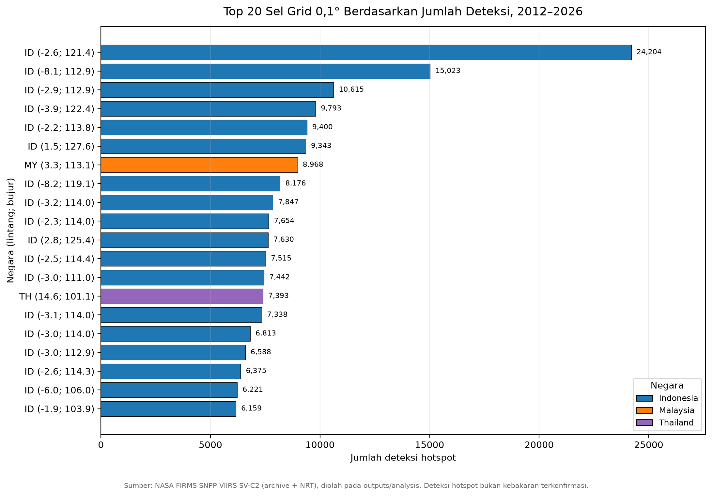
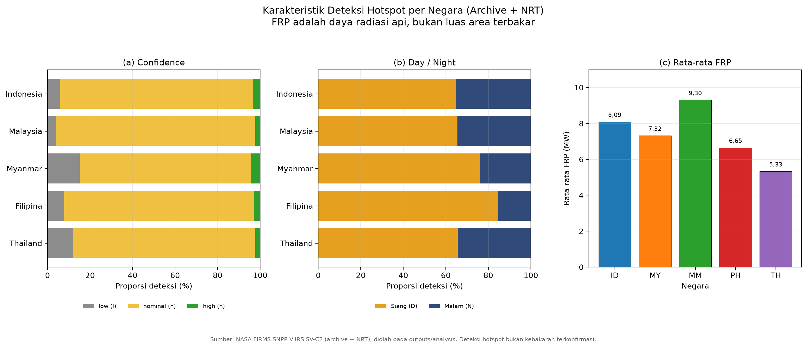

# Southeast Asia Forest & Land Fire Hotspot Analysis (2012–2026)

[](https://www.python.org/)
[](https://hadoop.apache.org/)
[](https://firms.modaps.eosdis.nasa.gov/)
[]()
[-yellow.svg)]()
[](LICENSE)

A comprehensive, descriptive Big Data analytics and data engineering project analyzing **12,416,036 satellite active fire hotspot detection records** across five ASEAN countries (**Indonesia, Malaysia, Myanmar, Philippines, and Thailand**) over nearly 15 years (January 20, 2012 – November 2, 2026).

This repository demonstrates end-to-end data lifecycle capabilities: distributed raw data storage in **Apache Hadoop HDFS**, high-performance stream processing using a **standalone Python single-pass algorithm**, strict **data quality assurance & reconciliation auditing**, and multi-dimensional descriptive analytics with publication-quality visualizations.

> **Methodological Scope & Boundary Notice:**
> - **Descriptive Observational Scope:** This study provides empirical, descriptive summaries of satellite observations. It does **not** construct predictive models, machine learning forecasts, or early warning systems (EWS).
> - **Detections vs. Fires:** Reported metrics reflect individual satellite thermal anomaly pixel records (375 m resolution), **not** verified discrete wildfire incidents or burned land area in hectares.
> - **Spatial Density Interpretation:** Grid aggregation at 0.1° (~11 km) resolution illustrates geographic clustering of thermal detections. In the absence of ground-truth field data, satellite imagery does **not** identify or prove specific causes (such as industrial operations, agricultural practices, peatland fires, or volcanic activity).
> - **Execution Architecture:** Hadoop HDFS is utilized in a single-node pseudo-distributed configuration (replication factor 1) for raw dataset storage (educational/testing setup, not a production-grade fault-tolerant cluster). Analytics execute as a local Python single-pass streaming pipeline reading CSV files line-by-line; **no Apache Spark, Hadoop MapReduce, or YARN frameworks were employed**.

---

## Executive Summary & Key Highlights

- **Big Data Scale:** Ingested and reconciled **12,416,036 records** (1,003,377,955 bytes / ~956.90 MiB) across 10 official NASA FIRMS VIIRS S-NPP datasets.
- **Storage Layer (HDFS):** Apache Hadoop 3.5.0 HDFS in a single-node pseudo-distributed configuration (replication factor 1), partitioning raw data into 16 blocks (128 MiB block size) verified as 100% HEALTHY (designed for testing distributed storage, not a production fault-tolerant multi-node cluster).
- **High-Efficiency Stream Compute:** A pure Python 3 single-pass generator algorithm processed the full 12.4M-row corpus in **125.8 seconds** with a peak memory working set of only **39.28 MiB RAM** ($O(N)$ time, $O(K)$ space complexity).
- **100% Row Audit Reconciliation:** Perfect row balance verified across all pipeline stages: Manifest (12,416,036) == Validation (12,416,036) == Analytics (12,416,036).
- **Transparent Data Quality Validation:** Audited 10 datasets: **6 PASS, 4 WARNING, 0 FAIL**. Identified and documented 895 records with zero FRP values (retained in analysis, flagged for review) and a 2-day date coverage gap between Myanmar Archive and NRT feeds without ad-hoc data fabrication.

---

## Key Analytical Findings

All findings are extracted directly from audited outputs in `outputs/analysis/`:

### 1. Geographic Distribution
Myanmar and Indonesia together account for **74.8%** of all recorded thermal detections in Southeast Asia:
- **Myanmar (MM):** **5,146,143 detections (41.45%)** | Sum of FRP across detections: 47,874,734.30 MW | Mean FRP: 9.30 MW per detection
- **Indonesia (ID):** **4,140,587 detections (33.35%)** | Sum of FRP across detections: 33,495,668.45 MW | Mean FRP: 8.09 MW per detection
- **Thailand (TH):** **2,439,229 detections (19.65%)** | Sum of FRP across detections: 13,004,722.55 MW | Mean FRP: 5.33 MW per detection
- **Philippines (PH):** **462,349 detections (3.72%)** | Sum of FRP across detections: 3,074,460.02 MW | Mean FRP: 6.65 MW per detection
- **Malaysia (MY):** **227,728 detections (1.83%)** | Sum of FRP across detections: 1,667,364.68 MW | Mean FRP: 7.32 MW per detection
- **Regional Total:** **12,416,036 detections** | **Cumulative Sum of FRP across detections: 99,116,950.00 MW** | **Regional Mean FRP: 7.98 MW per detection**

*(Important interpretation note on FRP metric: The 99.12M MW figure represents the cumulative arithmetic sum of recorded instantaneous FRP values across all 12.4M individual detection records over nearly 15 years; it is not a measure of simultaneous regional radiative power output.)*

### 2. Interannual Trends (2012–2026)
Thermal detection counts exhibited substantial annual variations across the 15-year period:
- **Historical Full-Year Peak (2015):** **1,486,854 detections** (ID: 875,824; MM: 358,914; TH: 185,922; PH: 39,882; MY: 26,312).
- **Secondary Full-Year Peaks:** **2014 (1,232,918 detections)** and **2019 (1,118,048 detections)**.
- **Historical Full-Year Minimum (2022):** **364,173 detections** (MM: 190,875; ID: 81,986; TH: 67,452; PH: 18,665; MY: 5,195).
- **Observation Boundary Note:** Data for 2012 begins on January 20 (898,488 detections) and 2026 concludes on November 2 (1,107,436 detections). Both are classified as partial observation periods and are separated in visualizations to avoid temporal comparison bias.

### 3. Seasonal Regimes (2013–2025 Full Years)
Analysis of monthly averages demonstrates distinct temporal clustering between subregions:
- **Northern Subregion (Myanmar & Thailand):** Peak detection density occurs between **February and April**, reaching an annual apex in March (MM March average: ~165,000; TH March average: ~85,000).
- **Southern Subregion (Indonesia & Malaysia):** Peak detection density occurs between **August and October**, reaching an annual apex in September (ID September average: ~105,000; MY September average: ~5,500).
- **Archipelagic Subregion (Philippines):** Exhibits a more evenly distributed profile across the year with modest elevation during March–May.
- *Methodological Caveat:* These distributions describe observed monthly timings only. Specific causal mechanisms (such as agricultural burning schedules or monsoon wind patterns) are not asserted without independent atmospheric and land-use records.

### 4. Physical & Sensor Attributes
- **Fire Radiative Power (FRP):** The mean FRP was **7.98 MW per detection** across the region (Myanmar highest at 9.30 MW; Thailand lowest at 5.33 MW). The cumulative sum of FRP across all detections totaled **99,116,950.00 MW** (an arithmetic aggregation across all detection timestamps, not simultaneous regional radiative power). 895 records (0.007%) recorded $FRP = 0.0\text{ MW}$; these records were retained in the analysis and flagged for review, noting that their physical validity as minimum sensor detection limits has not been independently verified.
- **Detection Confidence:** The vast majority of detections were evaluated as **nominal quality (85.51% / 10,616,605 records)**, with **10.94% low confidence (1,357,783)** and **3.56% high confidence (441,648)**.
- **Diurnal Pass Cycles:** **70.32% of detections (8,731,313)** occurred during daytime overpasses (`D`), while **29.68% (3,684,723)** were captured during nighttime overpasses (`N`).

### 5. Spatial Density Analysis (0.1° Grid Cells)
The regional area was partitioned into 31,529 unique 0.1° × 0.1° (~11 km) grid cells. The top 5 highest-density cells regionally were:
1. `ID (-2.6, 121.4)`: **24,204 detections** (Archive: 23,287, NRT: 917) — Sulawesi region
2. `ID (-8.1, 112.9)`: **15,023 detections** (Archive: 14,293, NRT: 730) — East Java region
3. `ID (-2.9, 112.9)`: **10,615 detections** (Archive: 8,367, NRT: 2,248) — Central Kalimantan region
4. `ID (-3.9, 122.4)`: **9,793 detections** (Archive: 8,774, NRT: 1,019) — Southeast Sulawesi region
5. `ID (-2.2, 113.8)`: **9,400 detections** (Archive: 5,470, NRT: 3,930) — Central Kalimantan region

*Note: Grid cell coordinates represent spatial concentration of sensor detections. They do not attribute causality to specific industries, peatlands, mines, or volcanoes.*

---

## Data Quality Assurance & Validation Audit

Data validation was executed via `scripts/02_validate.py` across all 10 datasets, producing detailed audit logs in `outputs/validation/`:

| Validation Check | Result | Metric / Details | Status |
|---|:---:|---|:---:|
| **Row Count Reconciliation** | 100% | 12,416,036 (Manifest) == 12,416,036 (Validation) == 12,416,036 (Analysis) | **PASS** |
| **Schema Uniformity** | 100% | 5 Archive datasets (15 cols with `type`), 5 NRT datasets (14 cols without `type`) | **PASS** |
| **Coordinate Range Check** | 100% | Latitude [-10.98° to 28.34°], Longitude [92.18° to 140.98°] within regional bounding-range box | **PASS** |
| **Cryptographic Integrity** | 100% | All 10 raw CSV files matched precomputed SHA-256 hashes in `config/datasets.json` | **PASS** |
| **Dataset-Level Quality** | 6 PASS / 4 WARN | 4 Archive datasets (MM: 733, ID: 123, TH: 35, MY: 4) flagged for $FRP = 0.0\text{ MW}$ | **WARNING** |
| **Temporal Continuity (Gaps)** | 4 PASS / 1 WARN | Myanmar Archive ended 2026-07-30; NRT started 2026-08-02 (2-day date coverage gap between feeds) | **WARNING** |

*(Note on Coordinate Range Check: This check validates numeric coordinate min/max bounding ranges; it does not perform polygon-level administrative boundary verification.)*

### Detailed Explanation of Validation Warnings:
1. **Zero FRP Values (895 records):** Detected in Archive feeds for Myanmar (733), Indonesia (123), Thailand (35), and Malaysia (4). These records recorded $FRP = 0.0\text{ MW}$; they are retained in the analysis and flagged for quality review, as their physical validity as minimum sensor detection thresholds has not been independently verified, while preserving them avoids arbitrary truncation bias.
2. **Myanmar Date Coverage Gap (2 days):** A 2-day date coverage gap exists between the Myanmar Archive feed (concluded on July 30, 2026) and the NRT feed (commenced on August 2, 2026), leaving July 31 and August 1, 2026 uncovered between the two feeds. This reflects a feed transition coverage gap in the acquired dataset rather than a confirmed absence of satellite overpasses. The pipeline documents this transition transparently without imputing synthetic data. The remaining four countries exhibit continuous coverage with zero gaps and zero overlaps.

---

## Visualizations

### 1. Annual Hotspot Trends (2012–2026)
*Logarithmic scale comparison across five ASEAN countries. Shaded gray regions highlight partial observation years (2012 from Jan 20; 2026 up to Nov 2).*


### 2. Monthly Seasonality Patterns (2013–2025)
*Long-term monthly averages (excluding partial years 2012 and 2026) showing observed divergence between the northern group (Feb–Apr peak) and southern group (Aug–Oct peak).*


### 3. Top 20 Spatial Hotspot Concentrations (0.1° Grid Cells)
*The 20 most concentrated 0.1° × 0.1° (~11 km) grid cells across Southeast Asia, labeled by country and coordinates.*


### 4. Detection Characteristics
*Comparison of detection confidence levels (low, nominal, high), diurnal pass ratios (daytime vs. nighttime), and mean Fire Radiative Power (MW).*


---

## System Architecture & Data Engineering Pipeline

```
+-----------------------------------------------------------------------------------+
|               APACHE HADOOP HDFS 3.5.0 (Single-Node Pseudo-Distributed)          |
|       Distributed Storage: 1.003 GB Raw CSVs | 16 Blocks (128 MiB) | HEALTHY      |
+-----------------------------------------------------------------------------------+
                                         |
                                         v
+-----------------------------------------------------------------------------------+
|               PYTHON 3 STANDALONE STREAMING ENGINE (No Spark/MapReduce/YARN)      |
|   Single-Pass Generator | csv.reader | Memory: 39.3 MiB | Runtime: 125.8 Seconds  |
+-----------------------------------------------------------------------------------+
                                         |
         +-------------------------------+-------------------------------+
         |                               |                               |
         v                               v                               v
+------------------+           +-------------------+           +--------------------+
|  TEMPORAL METRICS|           |  SPATIAL DENSITY  |           | PHYSICAL ATTRIBUTES|
|  Yearly Summary  |           |  0.1 Degree Grid  |           | FRP, Confidence,   |
|  Monthly Summary |           |  Top 20 Grids     |           | Day/Night, Type    |
+------------------+           +-------------------+           +--------------------+
         |                               |                               |
         +-------------------------------+-------------------------------+
                                         |
                                         v
+-----------------------------------------------------------------------------------+
|               AUDIT RECONCILIATION & QUALITY ASSURANCE                            |
|       Row Count: 100% PASS | Validation Quality: 6 PASS / 4 WARNING (895 FRP=0)   |
+-----------------------------------------------------------------------------------+
                                         |
                                         v
+-----------------------------------------------------------------------------------+
|                        DESCRIPTIVE OUTPUTS & VISUALIZATIONS                       |
|        6 Structured CSV/JSON/TXT Reports | 4 Publication-Quality PNG Charts        |
|        (No Predictive Modeling / No Early Warning System)                         |
+-----------------------------------------------------------------------------------+
```

### Storage Layer (Apache Hadoop HDFS)
- **Hadoop Version:** Apache Hadoop 3.5.0 on Ubuntu Linux (WSL2), OpenJDK 17.0.20 64-Bit.
- **Topology:** Single-Node Pseudo-Distributed (`fs.defaultFS = hdfs://localhost:9000`), 1 DataNode, replication factor 1 (educational single-node architecture; not a production-grade fault-tolerant multi-node cluster).
- **Block Configuration:** 128 MiB block size (`dfs.blocksize = 134217728`).
- **Cluster Status:** `hdfs fsck /karhutla/raw -files -blocks` confirms 16 data blocks, 0 corrupt blocks, 0 missing blocks (100% HEALTHY).

### Compute Layer (Python 3 Standalone Streaming)
- Custom single-pass streaming engine using pure Python standard library modules (`csv`, `json`, `math`, `collections`, `pathlib`).
- Iterates line-by-line across input files, updating in-memory hash accumulator tables ($O(G + Y + M + C)$ space complexity, where $G = 31,529$ grid cells, $Y = 15$ years, $M = 179$ months, $C = 10$ partitions).
- Completely eliminates memory-exhaustion risks: aggregates ~1 GB of CSV records with a peak working set of **39.28 MiB RAM**.
- Operates locally without distributed cluster dependencies (no Spark, MapReduce, or YARN).

---

## Repository Structure & Directory Roles

```
southeast-asia-forest-fire-analysis/
|-- config/
|   `-- datasets.json                  # Formal master manifest (paths, rows, bytes, SHA-256 hashes)
|-- data/
|   `-- sample/                        # Lightweight schema sample files (Archive & NRT format stubs)
|       |-- fire_archive_sample.csv
|       `-- fire_nrt_sample.csv
|-- scripts/
|   |-- common.py                      # Shared utilities, paths, and CSV streaming generator
|   |-- 00_build_manifest.py           # Manifest builder and cryptographic SHA-256 calculator
|   |-- 01_verify_baseline.py          # Baseline recomputation and historical consistency verification
|   |-- 02_validate.py                 # Multi-country data integrity, gap, and quality validator
|   |-- 03_analyze.py                  # Core single-pass streaming analytics engine
|   `-- 04_visualize.py                # Visualizer generating the 4 publication-quality PNG charts
|-- outputs/
|   |-- analysis/                      # Aggregated analytical datasets (CSV, JSON, TXT reports)
|   |   |-- yearly_summary.csv         # Annual detection counts by country and feed
|   |   |-- monthly_summary.csv        # Monthly detection counts by country and feed
|   |   |-- spatial_top20.csv          # Top 20 0.1° spatial concentration cells
|   |   |-- characteristics.csv        # FRP, confidence, diurnal, and type distributions
|   |   |-- analysis_summary.json      # Structured machine-readable summary with audit metadata
|   |   `-- analysis_report.txt        # Full plain-text summary of analytical results
|   |-- manifest/                      # Manifest verification logs and row summaries
|   |-- validation/                    # Data quality reports, gap logs, and anomaly summaries
|   |-- baseline/                      # Recomputed baseline outputs and verification logs
|   `-- visualization/                 # 4 high-resolution publication PNG charts
|       |-- 01_tren_tahunan.png
|       |-- 02_pola_bulanan.png
|       |-- 03_top20_grid.png
|       `-- 04_karakteristik.png
|-- docs/
|   |-- Laporan_Tugas_Big_Data_Publik.md # Comprehensive public descriptive technical report (Indonesian)
|   `-- pseudocode_algoritma.md        # Algorithmic pseudocode and computational complexity guide
|-- baseline/
|   `-- indonesia_v1/                  # Frozen historical single-country baseline artifacts with SHA-256
|-- DL_FIRE_SV-C2_837816/              # Standalone Indonesia pipeline scripts and baseline outputs
|-- data_asia_tenggara/                # Regional dataset directory with country subfolders and stubs
|-- hasil_asean/                       # HDFS file extraction logs and metadata tables
|-- metadata_hdfs.py                   # Standalone HDFS inspection utility
|-- requirements.txt                   # Minimal Python dependencies
|-- .gitignore                         # Production exclusion rules (protects ~956 MiB raw datasets)
|-- LICENSE                            # MIT Open Source License
`-- README.md                          # Project documentation (this file)
```

### Explanatory Notes on Historical Directories:
- **`baseline/indonesia_v1/`:** Stores the frozen historical Indonesia baseline outputs along with cryptographic checksums (`SHA256SUMS.txt`, `baseline_meta.json`). Used by `scripts/01_verify_baseline.py` to ensure multi-country pipeline outputs reproduce the legacy single-country findings with zero regression.
- **`DL_FIRE_SV-C2_837816/`:** Contains the original standalone single-country pipeline scripts (`analisis.py`, `validasi.py`, `visualisasi.py`) and its historical outputs (`hasil_analisis/`). Preserved for auditability and lineage tracking.
- **`data_asia_tenggara/`:** Houses the regional ASEAN dataset structure. Contains country subdirectories (`Malaysia/`, `Myanmar/`, `Philippines/`, `Thailand/`), download Readme stubs, and validation helper `cek_file.py`. The heavy raw CSV files are excluded by `.gitignore`.
- **`hasil_asean/`:** Contains preliminary HDFS file metadata (`metadata_file.csv`) and extraction logs (`log_metadata.txt`) generated during the initial HDFS cluster staging.

---

## Reproducibility & Execution Guide

### Prerequisites
- **Python:** Version 3.10 or higher.
- **Dependencies:** `matplotlib>=3.8.0` (required for chart generation). Optional packages `pandas>=2.0.0` and `numpy>=1.26.0` are recommended for ad-hoc inspection.

```bash
git clone https://github.com/KopalZ/southeast-asia-forest-fire-analysis.git
cd southeast-asia-forest-fire-analysis
pip install -r requirements.txt
```

### Reproducing Visualizations Immediately (Zero-Data Download)
Because all aggregated analytical outputs are version-controlled in `outputs/analysis/`, you can regenerate the 4 publication-quality PNG charts immediately without downloading the 956 MiB raw dataset:

```bash
python scripts/04_visualize.py
```
Outputs are regenerated deterministically in `outputs/visualization/`.

---

### End-to-End Pipeline Execution (With Raw Datasets)

To execute the data validation and analytical streaming pipeline from scratch:

#### Step 1: Obtain the Raw Datasets from NASA FIRMS
Download the 10 CSV extracts for VIIRS Suomi-NPP (375 m, Collection SV-C2) from the [NASA FIRMS Archive Download Tool](https://firms.modaps.eosdis.nasa.gov/download/):
- **Indonesia (Area 837816):** Archive (2012-01-20 to 2026-07-31) and NRT (2026-08-01 to 2026-11-02)
- **Malaysia (Area 838165):** Archive (2012-01-20 to 2026-07-31) and NRT (2026-08-01 to 2026-11-02)
- **Myanmar (Area 838170):** Archive (2012-01-20 to 2026-07-30) and NRT (2026-08-02 to 2026-11-01)
- **Philippines (Area 838168):** Archive (2012-01-20 to 2026-07-31) and NRT (2026-08-01 to 2026-11-02)
- **Thailand (Area 838094):** Archive (2012-01-20 to 2026-07-31) and NRT (2026-08-01 to 2026-11-01)

#### Step 2: Place Datasets in the Expected Paths
Ensure files are placed in their respective local directories as specified in `config/datasets.json`:
- `DL_FIRE_SV-C2_837816/fire_archive_SV-C2_837816.csv`
- `DL_FIRE_SV-C2_837816/fire_nrt_SV-C2_837816.csv`
- `data_asia_tenggara/Malaysia/fire_archive_SV-C2_838165.csv`
- `data_asia_tenggara/Malaysia/fire_nrt_SV-C2_838165.csv`
- `data_asia_tenggara/Myanmar/fire_archive_SV-C2_838170.csv`
- `data_asia_tenggara/Myanmar/fire_nrt_SV-C2_838170.csv`
- `data_asia_tenggara/Philippines/fire_archive_SV-C2_838168.csv`
- `data_asia_tenggara/Philippines/fire_nrt_SV-C2_838168.csv`
- `data_asia_tenggara/Thailand/fire_archive_SV-C2_838094.csv`
- `data_asia_tenggara/Thailand/fire_nrt_SV-C2_838094.csv`

#### Step 3: Run the Pipeline Steps

```bash
# Optional: Rebuild dataset manifest and recompute SHA-256 cryptographic hashes
python scripts/00_build_manifest.py

# Optional: Verify historical Indonesia baseline reproducibility
python scripts/01_verify_baseline.py

# Step A: Run data integrity, schema consistency, and gap validation
python scripts/02_validate.py

# Step B: Execute the single-pass multi-country streaming analytics
python scripts/03_analyze.py

# Step C: Generate the 4 publication-quality visualization charts
python scripts/04_visualize.py
```

---

## Methodological Notes & Limitations

1. **Descriptive Observational Scope:** This study provides observational summaries of satellite detections. It does **not** perform predictive modeling, fire propagation simulation, or early warning system (EWS) forecasting.
2. **Detection Counts vs. Fires:** Reported figures represent individual satellite thermal detection pixel records, **not** confirmed wildfire events or burned surface areas. A single large fire can produce multiple detection points across successive orbits.
3. **Fire Radiative Power (FRP):** FRP (MW) measures the instantaneous rate of radiant heat output at the moment of satellite overpass. The cumulative figure (99,116,950.00 MW) is the arithmetic sum of recorded FRP across all individual detection records over nearly 15 years, not a simultaneous regional power output. Regional mean FRP is 7.98 MW per detection. FRP serves as a physical proxy for detection intensity, **not burned area in hectares**.
4. **Spatial Grid Interpretation:** Aggregation into 0.1° (~11 km) grid cells identifies areas of high detection concentration; it does **not** prove, identify, or attribute physical causes (such as industrial operations, agricultural practices, peatland fires, or volcanic activity) without independent ground-truth verification.
5. **Confidence Scoring:** VIIRS confidence values are categorized as `'l'` (low), `'n'` (nominal), and `'h'` (high). Over 85% of detections in this study are nominal quality.
6. **Partial Years:** Data for 2012 begins on January 20, and 2026 data concludes on November 2. Both years are flagged with `is_partial_year = true` and are separated from full-year averages to avoid comparison bias.
7. **Zero FRP Values:** 895 records (0.007% of the corpus) recorded $FRP = 0.0\text{ MW}$. These records were retained in the analytical calculations and flagged for review; their physical validity as true sensor detection thresholds has not been independently verified.
8. **Exclusion of Redundant Data:** File `DL_FIRE_SV-C2_837806/fire_archive_SV-C2_837806.csv` (1,708,204 rows; Indonesia 2020–2025) was identified as a subset duplicate of `ID-archive-837816` and explicitly excluded to prevent double counting.

---

## References and Data Sources

- **Data Provider:** NASA FIRMS (Fire Information for Resource Management System) VIIRS active fire data product.
- **Sensor Instrument:** Suomi National Polar-orbiting Partnership (S-NPP) 375 m VIIRS active fire detection.
- **Distributed System:** Apache Hadoop HDFS distributed file system architecture.

---

## License

This project and its analytical codebase are released under the [MIT License](LICENSE) for academic and open scientific research.
