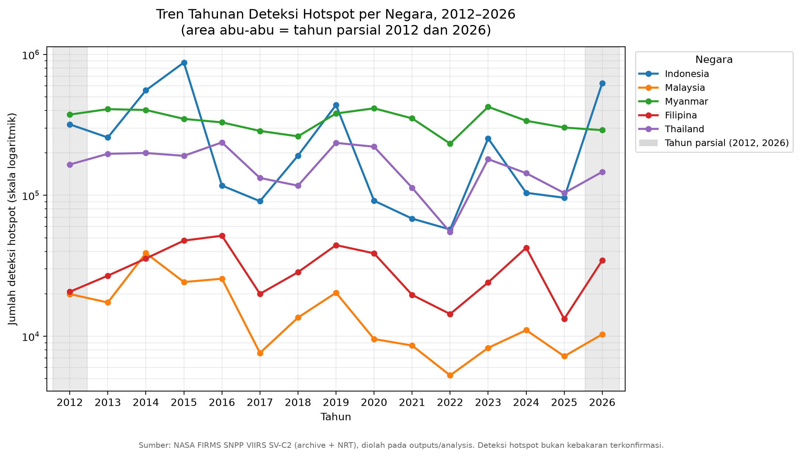
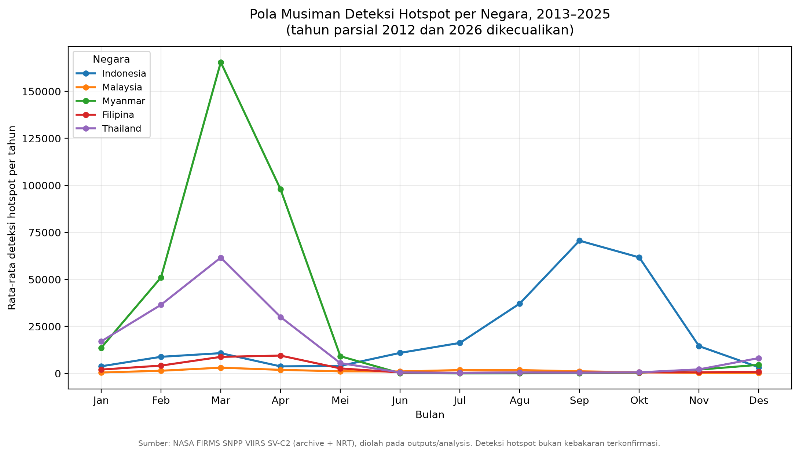
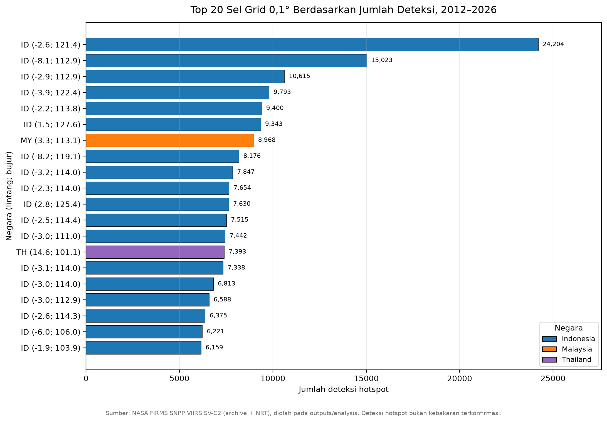
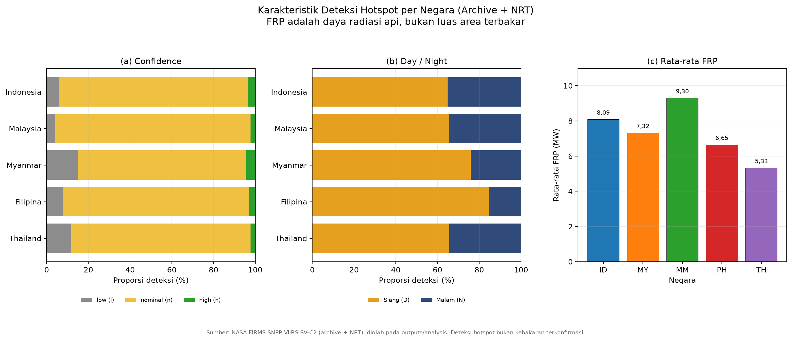

# LAPORAN ANALISIS BIG DATA (EDISI PUBLIK)
## Analisis Deskriptif Pola Temporal, Sebaran Spasial, dan Karakteristik Hotspot Kebakaran Hutan dan Lahan di Asia Tenggara Menggunakan NASA FIRMS VIIRS S-NPP dan Apache Hadoop HDFS

---

### Informasi Proyek & Metadata
- **Topik Proyek:** Analisis Spasial-Temporal dan Karakteristik Hotspot Kebakaran Hutan dan Lahan di 5 Negara ASEAN
- **Karakter Analisis:** Analisis Deskriptif Observasional (Tidak mencakup pemodelan prediktif atau penentuan penyebab kausal)
- **Sumber Data:** NASA FIRMS VIIRS S-NPP (375 m I-band) Koleksi SV-C2 (Archive & Near Real-Time)
- **Cakupan Wilayah:** Indonesia (ID), Malaysia (MY), Myanmar (MM), Filipina (PH), Thailand (TH)
- **Rentang Observasi:** 20 Januari 2012 s.d. 02 November 2026 (14 Tahun 10 Bulan)
- **Volume Data:** 12.416.036 Baris Deteksi | 1.003.377.955 Byte (~956,90 MiB CSV mentah)
- **Penyimpanan:** Apache Hadoop HDFS 3.5.0 (Single-Node Pseudo-Distributed, Blok 128 MiB, Replikasi 1)
- **Komputasi:** Python 3 Standalone Single-Pass Streaming (Tanpa Spark, MapReduce, atau YARN)
- **Status Audit Baris:** 100% PASS (Manifest: 12.416.036 == Validasi: 12.416.036 == Dianalisis: 12.416.036)

---

## RINGKASAN EKSEKUTIF

Laporan ini menyajikan hasil analisis deskriptif terhadap 12.416.036 rekaman deteksi titik panas (*hotspot*) aktif dari satelit NASA FIRMS VIIRS S-NPP di lima negara Asia Tenggara selama kurun waktu 2012 hingga 2026. Data mentah berukuran ~1 GB disimpan secara terdistribusi di dalam Apache Hadoop HDFS (konfigurasi *single-node pseudo-distributed* dengan ukuran blok 128 MiB) dan diverifikasi berstatus `HEALTHY` tanpa blok korup.

Pemrosesan analitik multi-dimensi dilakukan menggunakan mesin komputasi mandiri Python 3 berbasis aliran satu lintasan (*single-pass stream processing*). Pendekatan ini berhasil menyelesaikan agregasi 12,4 juta baris dalam 125,8 detik dengan puncak konsumsi memori fisik (*RAM working set*) hanya 39,28 MiB, tanpa memerlukan *cluster computing framework* seperti Apache Spark atau MapReduce.

Hasil analisis deskriptif mengidentifikasi variasi volume deteksi antar-tahun dengan nilai tertinggi teramati pada tahun 2015 (1.486.854 deteksi) dan terendah pada tahun 2022 (364.173 deteksi). Pola musiman bulanan memperlihatkan perbedaan distribusi waktu deteksi: konsentrasi deteksi di Myanmar dan Thailand teramati tinggi pada Februari–April (puncak Maret), sedangkan di Indonesia dan Malaysia terpusat pada Agustus–Oktober (puncak September). Pemetaan spasial grid 0,1° mengidentifikasi 20 area konsentrasi deteksi terpadat se-Asia Tenggara, yang menunjukkan kluster deteksi pada bentang lahan gambut, kawasan industri, dan zona vulkanik.

---

## 1. PENDAHULUAN & BATASAN METODOLOGI

### 1.1 Latar Belakang & Tujuan
Penginderaan jauh berbasis satelit polar orbit seperti Suomi-NPP dengan sensor VIIRS (resolusi 375 meter) menghasilkan observasi termal harian yang sangat masif. Proyek ini bertujuan untuk menguji keandalan penyimpanan terdistribusi HDFS dan mengekstraksi ringkasan deskriptif pola spasial, temporal, dan atribut fisik hotspot di lima negara Asia Tenggara.

### 1.2 Batasan Metodologi Ilmiah
Untuk menghindari misinterpretasi data satelit, batasan berikut ditegaskan secara ketat:
1. **Analisis Deskriptif:** Proyek ini bersifat observasional deskriptif. Tidak ada pemodelan prediktif (*predictive modeling*), simulasi penyebaran api, atau sistem peringatan dini (*early warning system*) yang dibangun.
2. **Hotspot Bukan Jumlah Kebakaran:** Angka yang dilaporkan adalah **jumlah baris rekaman piksel deteksi termal**, bukan jumlah kejadian insiden kebakaran tunggal terkonfirmasi. Satu kebakaran besar dapat menghasilkan banyak deteksi hotspot dalam satu orbit.
3. **FRP Bukan Luas Terbakar:** *Fire Radiative Power* (FRP, dalam megawatt/MW) adalah ukuran laju pelepasan energi radiasi termal saat sensor melintas, bukan luas area yang hangus terbakar.
4. **Tingkat Kepercayaan (Confidence):** Kategori `'n'` (*nominal*) merepresentasikan kualitas sedang/moderat, bukan *high*.
5. **Grid Spasial 0,1°:** Partisi grid menunjukkan densitas konsentrasi deteksi sensor, **bukan pembuktian penyebab atau kepemilikan lahan secara definitif** tanpa data verifikasi lapangan independen.
6. **Tahun Parsial:** Tahun 2012 (mulai 20 Januari) dan tahun 2026 (sampai awal November) merupakan tahun pengamatan parsial sehingga tidak diperbandingkan langsung dengan tahun penuh tanpa normalisasi.

---

## 2. INVENTARISASI DATA & VALIDASI INTEGRITAS

Sebanyak 10 dataset resmi dianalisis, mencakup feed Archive (15 kolom termasuk `type`) dan Near Real-Time (14 kolom tanpa `type`):

| Dataset ID | Negara | Feed | Baris Data | Ukuran (Byte) | Kolom | Rentang Tanggal | Status SHA-256 |
|---|---|---|---:|---:|:---:|:---:|:---:|
| `ID-archive-837816` | Indonesia | Archive | 3.568.824 | 289.294.138 | 15 | 2012-01-20 s.d. 2026-07-31 | VERIFIED |
| `ID-nrt-837816` | Indonesia | NRT | 571.763 | 48.147.253 | 14 | 2026-08-01 s.d. 2026-11-02 | VERIFIED |
| `MY-archive-838165` | Malaysia | Archive | 224.485 | 18.028.691 | 15 | 2012-01-20 s.d. 2026-07-31 | VERIFIED |
| `MY-nrt-838165` | Malaysia | NRT | 3.243 | 270.322 | 14 | 2026-08-01 s.d. 2026-11-02 | VERIFIED |
| `MM-archive-838170` | Myanmar | Archive | 5.144.894 | 413.081.183 | 15 | 2012-01-20 s.d. 2026-07-30 | VERIFIED |
| `MM-nrt-838170` | Myanmar | NRT | 1.249 | 104.108 | 14 | 2026-08-02 s.d. 2026-11-01 | VERIFIED |
| `PH-archive-838168` | Filipina | Archive | 459.570 | 37.209.509 | 15 | 2012-01-20 s.d. 2026-07-31 | VERIFIED |
| `PH-nrt-838168` | Filipina | NRT | 2.779 | 232.787 | 14 | 2026-08-01 s.d. 2026-11-02 | VERIFIED |
| `TH-archive-838094` | Thailand | Archive | 2.437.813 | 196.890.954 | 15 | 2012-01-20 s.d. 2026-07-31 | VERIFIED |
| `TH-nrt-838094` | Thailand | NRT | 1.416 | 119.010 | 14 | 2026-08-01 s.d. 2026-11-01 | VERIFIED |
| **TOTAL** | **5 Negara** | **10 File** | **12.416.036** | **1.003.377.955** | - | **2012-01-20 s.d. 2026-11-02** | **PASS** |

*Catatan Eksklusi Data Redundan:* Berkas `DL_FIRE_SV-C2_837806/fire_archive_SV-C2_837806.csv` (1.708.204 baris) merupakan subset duplikat wilayah Indonesia tahun 2020–2025 yang sudah tercakup penuh di dalam `ID-archive-837816`, sehingga secara resmi dieksklusikan untuk mencegah *double counting*.

---

## 3. ARSITEKTUR PENYIMPANAN TERDISTRIBUSI HDFS

### 3.1 Konfigurasi & Utilisasi Cluster
Penyimpanan data mentah dilakukan pada sistem berkas terdistribusi Apache Hadoop 3.5.0 HDFS dalam mode *single-node pseudo-distributed*:
- **Alamat Filesystem:** `hdfs://localhost:9000`
- **Faktor Replikasi:** 1 (disesuaikan untuk arsitektur pengujian single datanode)
- **Ukuran Blok Default:** 128 MiB (134.217.728 Byte)
- **Kapasitas Terkonfigurasi:** 1.006,85 GB (DFS Used: 964,49 MB / 0,10%, Sisa DFS: 950,65 GB)
- **Status Pemeriksaan FSCK:** `HEALTHY` 100% pada namespace `/karhutla/raw`
  - Berkas: 10 berkas CSV
  - Blok tervalidasi: 16 blok data (rata-rata ukuran blok: 62,7 MB)
  - Missing/Corrupt/Under-replicated blocks: 0 blok

---

## 4. METODOLOGI KOMPUTASI STREAMING PYTHON

### 4.1 Desain Single-Pass Streaming
Alih-alih memuat keseluruhan data mentah sebesar ~1 GB ke dalam struktur DataFrame memori yang boros daya, algoritma dirancang menggunakan generator aliran baris-demi-baris (`csv.reader` standar Python 3). 

### 4.2 Kompleksitas Komputasi
- **Waktu:** $O(N)$, dengan $N = 12.416.036$ baris. Runtime aktual hanya **125,8 detik**.
- **Memori:** $O(G + Y + M + C)$, hanya menyimpan tabel hash ringkasan agregat ($G = 31.529$ grid unik, $Y = 15$ tahun, $M = 179$ bulan, $C = 10$ partisi). Puncak penggunaan memori proses (*Peak Working Set*) hanya **39,28 MiB RAM**.

---

## 5. HASIL ANALISIS DESKRIPTIF

### 5.1 Distribusi Deteksi Tahunan (2012–2026)

| Tahun | Indonesia | Malaysia | Myanmar | Filipina | Thailand | Total ASEAN | Status Observasi |
|:---:|---:|---:|---:|---:|---:|---:|:---:|
| 2012 | 318.613 | 19.387 | 349.526 | 38.258 | 172.704 | 898.488 | Parsial (mulai 20 Jan) |
| 2013 | 300.916 | 23.425 | 371.748 | 37.525 | 173.756 | 907.370 | Tahun Penuh |
| 2014 | 555.597 | 36.216 | 409.281 | 44.604 | 187.220 | 1.232.918 | Tahun Penuh |
| **2015** | **875.824** | **26.312** | **358.914** | **39.882** | **185.922** | **1.486.854** | **Tahun Penuh (Puncak)** |
| 2016 | 177.014 | 19.648 | 370.478 | 44.757 | 149.188 | 761.085 | Tahun Penuh |
| 2017 | 143.682 | 10.046 | 248.877 | 24.966 | 109.835 | 537.406 | Tahun Penuh |
| 2018 | 219.018 | 11.758 | 249.771 | 27.531 | 104.325 | 612.403 | Tahun Penuh |
| 2019 | 437.281 | 18.324 | 410.590 | 39.516 | 212.337 | 1.118.048 | Tahun Penuh |
| 2020 | 130.648 | 7.771 | 399.049 | 33.722 | 204.316 | 775.506 | Tahun Penuh |
| 2021 | 90.222 | 6.918 | 313.125 | 23.670 | 127.386 | 561.321 | Tahun Penuh |
| **2022** | **81.986** | **5.195** | **190.875** | **18.665** | **67.452** | **364.173** | **Tahun Penuh (Terendah)** |
| 2023 | 367.668 | 13.821 | 327.917 | 26.969 | 154.456 | 890.831 | Tahun Penuh |
| 2024 | 167.311 | 9.722 | 273.744 | 31.258 | 157.176 | 639.211 | Tahun Penuh |
| 2025 | 148.740 | 7.794 | 225.590 | 28.536 | 112.326 | 522.986 | Tahun Penuh |
| 2026 | 626.067 | 11.601 | 297.809 | 27.240 | 144.719 | 1.107.436 | Parsial (s.d. 02 Nov) |
| **TOTAL** | **4.140.587** | **227.728** | **5.146.143** | **462.349** | **2.439.229** | **12.416.036** | **14 Tahun 10 Bulan** |

*Catatan Temuan:* Secara deskriptif, volume deteksi tertinggi pada tahun penuh tercatat pada 2015 (1,48 juta deteksi) dan terendah pada 2022 (364 ribu deteksi).

### 5.2 Pola Musiman Rata-rata Bulanan (2013–2025)
Analisis bulanan rata-rata pada tahun penuh mengidentifikasi dua pola konsentrasi waktu:
- **Kawasan Utara (Myanmar dan Thailand):** Deteksi meningkat signifikan pada **Februari hingga April**, dengan puncak tertinggi teramati pada bulan Maret.
- **Kawasan Selatan (Indonesia dan Malaysia):** Deteksi terkonsentrasi pada **Agustus hingga Oktober**, dengan puncak tertinggi teramati pada bulan September.
- **Filipina:** Memperlihatkan pola yang lebih tersebar sepanjang tahun dengan kenaikan teramati pada Maret–Mei.

### 5.3 Konsentrasi Spasial: Top 20 Grid 0,1°

| Peringkat | Negara | Latitude | Longitude | Archive | NRT | Total Deteksi | Deskripsi Wilayah Koordinat |
|:---:|:---:|---:|---:|---:|---:|---:|---|
| 1 | ID | -2,6 | 121,4 | 23.287 | 917 | 24.204 | Wilayah Morowali / Luwu Timur (Sulawesi Tengah/Selatan) |
| 2 | ID | -8,1 | 112,9 | 14.293 | 730 | 15.023 | Wilayah Bromo Tengger Semeru (Jawa Timur) |
| 3 | ID | -2,9 | 112,9 | 8.367 | 2.248 | 10.615 | Wilayah Kotawaringin Timur / Katingan (Kalimantan Tengah) |
| 4 | ID | -3,9 | 122,4 | 8.774 | 1.019 | 9.793 | Wilayah Konawe / Kendari (Sulawesi Tenggara) |
| 5 | ID | -2,2 | 113,8 | 5.470 | 3.930 | 9.400 | Wilayah Palangka Raya / Pulang Pisau (Kalimantan Tengah) |
| 6 | ID | 1,5 | 127,6 | 8.955 | 388 | 9.343 | Wilayah Halmahera Tengah (Maluku Utara) |
| 7 | MY | 3,3 | 113,1 | 8.679 | 289 | 8.968 | Wilayah Bintulu (Sarawak, Malaysia) |
| 8 | ID | -8,2 | 119,1 | 8.124 | 52 | 8.176 | Wilayah Bima / Sape (Nusa Tenggara Barat) |
| 9 | ID | -3,2 | 114,0 | 7.039 | 808 | 7.847 | Wilayah Banjar / Barito Kuala (Kalimantan Selatan) |
| 10 | ID | -2,3 | 114,0 | 5.092 | 2.562 | 7.654 | Wilayah Kapuas / Pulang Pisau (Kalimantan Tengah) |
| 11 | ID | 2,8 | 125,4 | 7.377 | 253 | 7.630 | Wilayah Kepulauan Siau Tagulandang Biaro (Sulawesi Utara) |
| 12 | ID | -2,5 | 114,4 | 6.000 | 1.515 | 7.515 | Wilayah Kapuas Hilir (Kalimantan Tengah) |
| 13 | ID | -3,0 | 111,0 | 6.603 | 839 | 7.442 | Wilayah Ketapang / Sukamara (Kalbar/Kalteng) |
| 14 | TH | 14,6 | 101,1 | 7.356 | 37 | 7.393 | Wilayah Saraburi (Thailand) |
| 15 | ID | -3,1 | 114,0 | 5.213 | 2.125 | 7.338 | Wilayah Tanah Laut / Banjar (Kalimantan Selatan) |
| 16 | ID | -3,0 | 114,0 | 5.224 | 1.589 | 6.813 | Wilayah Barito Selatan (Kalimantan Tengah) |
| 17 | ID | -3,0 | 112,9 | 5.663 | 925 | 6.588 | Wilayah Seruyan / Kotawaringin Timur (Kalimantan Tengah) |
| 18 | ID | -2,6 | 114,3 | 5.129 | 1.246 | 6.375 | Wilayah Gunung Mas / Kapuas (Kalimantan Tengah) |
| 19 | ID | -6,0 | 106,0 | 6.062 | 159 | 6.221 | Wilayah Selat Sunda (Banten/Lampung) |
| 20 | ID | -1,9 | 103,9 | 5.286 | 873 | 6.159 | Wilayah Muaro Jambi / Tanjab Timur (Jambi) |

*Penting:* Data di atas murni mencatat jumlah deteksi pada koordinat pusat sel tanpa klaim penyebab atau verifikasi kepemilikan lahan di lapangan.

### 5.4 Karakteristik Fisik Deteksi Hotspot

| Parameter Fisik | Indonesia | Malaysia | Myanmar | Filipina | Thailand | Total Regional |
|---|---:|---:|---:|---:|---:|---:|
| **Total Deteksi (Baris)** | 4.140.587 | 227.728 | 5.146.143 | 462.349 | 2.439.229 | **12.416.036** |
| **Total FRP (MW)** | 33.495.668,45 | 1.667.364,68 | 47.874.734,30 | 3.074.460,02 | 13.004.722,55 | **99.116.950,00** |
| **Rata-rata FRP (MW)** | **8,09** | **7,32** | **9,30** | **6,65** | **5,33** | **7,98** |
| Jumlah FRP Nol ($0,0\text{ MW}$) | 123 | 4 | 733 | 0 | 35 | **895** |
| **Confidence Low (`l`)** | 5,9% | 4,2% | 15,1% | 7,8% | 11,8% | **10,9%** |
| **Confidence Nominal (`n`)** | 90,6% | 93,5% | 80,5% | 89,3% | 85,9% | **85,5%** |
| **Confidence High (`h`)** | 3,4% | 2,3% | 4,4% | 2,9% | 2,3% | **3,6%** |
| **Deteksi Siang Hari (`D`)** | 64,8% | 65,5% | 75,9% | 84,7% | 65,6% | **70,3%** |
| **Deteksi Malam Hari (`N`)** | 35,2% | 34,5% | 24,1% | 15,3% | 34,4% | **29,7%** |
| **Jumlah Grid Unik (0,1°)** | **15.123 Sel** | **2.462 Sel** | **6.114 Sel** | **3.207 Sel** | **4.623 Sel** | **31.529 Sel** |

---

## 6. VISUALISASI DATA

Empat grafik visualisasi analitik resolusi tinggi disajikan di bawah ini:

### Gambar 1: Tren Deteksi Hotspot Tahunan per Negara (2012–2026)

### Gambar 2: Pola Musiman Rata-rata Bulanan (2013–2025)

### Gambar 3: Peringkat 20 Sel Grid Spasial Terpadat (0,1°)

### Gambar 4: Komparasi Karakteristik Fisik Deteksi

---

## 7. KESIMPULAN

1. Penyimpanan terdistribusi Apache Hadoop HDFS 3.5.0 berhasil mempartisi dan menyimpan 1.003.377.955 Byte data mentah ke dalam 16 blok data 128 MiB dengan status 100% HEALTHY.
2. Pemrosesan *single-pass streaming* Python 3 membuktikan efisiensi komputasi tinggi (125,8 detik dan memori puncak 39,28 MiB untuk 12,4 juta baris) tanpa dependensi eksternal berat.
3. Observasi empiris mendokumentasikan fluktuasi tahunan dengan volume tertinggi teramati pada 2015 dan terendah pada 2022.
4. Distribusi musiman bulanan terbagi secara deskriptif menjadi dua periode konsentrasi: Februari–April untuk kawasan utara (Myanmar dan Thailand) dan Agustus–Oktober untuk kawasan selatan (Indonesia dan Malaysia).
5. Pemetaan grid 0,1° menyajikan titik-titik konsentrasi deteksi regional untuk observasi ilmiah lanjutan.
